# Northlane Motors — Car Dealership Inventory System

A full-stack inventory system for a car dealership, built test-first for the
**Incubyte AI Kata (TDD)**. Customers browse, search and buy vehicles from a live
catalogue; administrators add, edit, restock and remove vehicles. Stock levels
are kept correct under concurrent purchases by the database itself.

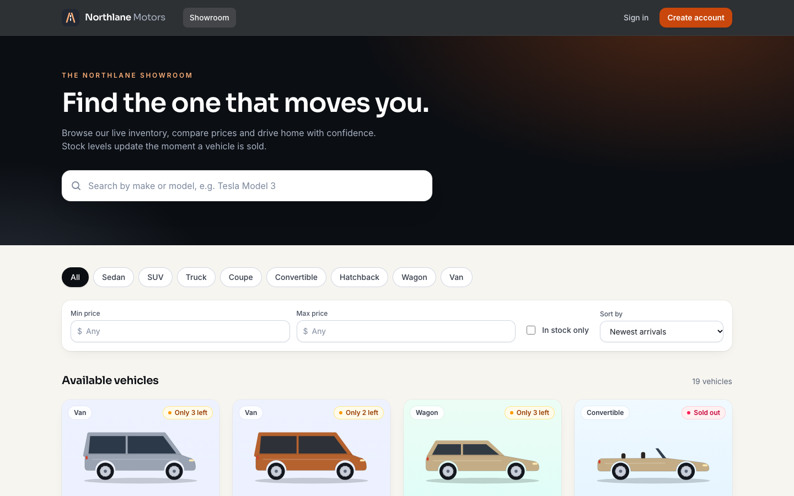

|              |                                                                                                                                               |
| ------------ | --------------------------------------------------------------------------------------------------------------------------------------------- |
| **Backend**  | Node.js · TypeScript · Express 5 · PostgreSQL 17 · Prisma 7 · Zod · JWT · Argon2id                                                            |
| **Frontend** | React 19 · TypeScript · Vite · Tailwind CSS v4 · React Router · TanStack Query                                                                |
| **Tests**    | Vitest · Supertest (real PostgreSQL) · React Testing Library · MSW · Playwright                                                               |
| **Results**  | 174 backend + 62 frontend + 11 end-to-end tests passing · 99 % backend / 97 % frontend line coverage — see [Test report](docs/TEST_REPORT.md) |

---

## Contents

1. [Features](#features)
2. [Architecture](#architecture)
3. [Database schema](#database-schema)
4. [Getting started](#getting-started)
5. [Environment variables](#environment-variables)
6. [Running the tests](#running-the-tests)
7. [API reference](#api-reference)
8. [Authentication and authorisation](#authentication-and-authorisation)
9. [Inventory correctness](#inventory-correctness)
10. [Security considerations](#security-considerations)
11. [Screenshots](#screenshots)
12. [Development process (TDD and Git history)](#development-process)
13. [My AI Usage](#my-ai-usage)
14. [Known limitations and future improvements](#known-limitations-and-future-improvements)
15. [Deployment notes](#deployment-notes)

---

## Features

**Customers**

- Register and sign in (validated forms, generic error on bad credentials).
- Browse a responsive showroom of every vehicle, with stock badges
  (_In stock_, _Only n left_, _Sold out_).
- Free-text search (every word must match make or model), category pills,
  min/max price, _in stock only_, five sort orders and pagination — all kept in
  the URL, so searches can be shared and the back button works.
- Vehicle detail page with specifications.
- **Purchase** button on every vehicle, disabled when stock is zero; a confirm
  dialog with quantity (up to 5, never more than in stock) and a live total.
  Retries are safe: each intended purchase carries an `Idempotency-Key`.
- Stock shown everywhere refreshes after every purchase, including failed ones.

**Administrators** (role `ADMIN`)

- Inventory dashboard: vehicle count, units in stock, low-stock and sold-out
  counts, total inventory value.
- Add and edit vehicles (Zod-validated forms with a live illustration preview).
- Restock (atomic increment) and delete (after a confirmation dialog).

**Product details**

- Original visual identity: graphite and copper palette, Sora/Inter type,
  generated SVG side-profile artwork per body style (no third-party images).
- Accessible: semantic landmarks, labelled controls with inline errors,
  focus-trapped modals that restore focus, skip link, keyboard-reachable cards,
  WCAG AA colour contrast on primary actions, reduced-motion support.
- Loading skeletons, empty, no-match, error-with-retry and not-found states.

## Architecture

A modular monolith in an npm-workspaces repository.

```
car-dealership-inventory/
├── backend/                      Express API
│   ├── prisma/                   schema.prisma, migrations/ (incl. hand-written CHECK constraints), seed.ts
│   ├── scripts/                  create-admin.ts, e2e-server.ts
│   ├── src/
│   │   ├── app.ts                createApp({ db, config, logger }) — no globals, fully injectable
│   │   ├── server.ts             process entry point (config validation, graceful shutdown)
│   │   ├── config/env.ts         Zod-validated environment
│   │   ├── db/                   Prisma client factory (pg driver adapter), error helpers
│   │   ├── errors/               AppError + factories (400/401/403/404/409/422)
│   │   ├── http/validate.ts      parseInput(schema, input) → typed data or field-level 400
│   │   ├── middleware/           authenticate (JWT + CSRF + roles), error handler
│   │   ├── bootstrap/            demo catalogue seed, ensureAdmin
│   │   └── modules/
│   │       ├── auth/             schemas, service, token service, password hashing, cookies, routes
│   │       ├── vehicles/         schemas, DTO, service (CRUD, search), routes
│   │       ├── inventory/        purchase / restock / summary service and routes
│   │       └── health/
│   └── tests/                    unit/ and integration/ (Supertest against a real *_test database)
├── frontend/                     React SPA
│   └── src/
│       ├── app/                  providers, routes, guards, query client
│       ├── pages/                Catalogue, VehicleDetail, Login, Register, admin/*
│       ├── components/           ui/, vehicles/, catalogue/, purchase/, admin/, toast/
│       ├── hooks/                useAuth, useVehicles, useVehicleFilters, useInventoryMutations …
│       ├── services/             api-client.ts (fetch + CSRF + errors), api.ts (typed endpoints)
│       ├── lib/                  formatting, validation schemas, safe redirects
│       └── test/                 MSW server, fixtures, stateful fake API, render helper
├── e2e/                          Playwright specs + helpers
├── docs/                         PLAN.md, TEST_REPORT.md, screenshots/, ai-logs/, test-report/
├── scripts/                      db.sh (local Postgres), init-env.mjs, export-claude-transcript.mjs
├── .github/workflows/ci.yml
├── docker-compose.yml
└── .env.example
```

**Backend layering.** Routes only parse input (Zod) and shape responses;
services hold the business rules and receive the Prisma client by injection;
PostgreSQL enforces the invariants that must never break. Because `createApp`
takes its dependencies as arguments, tests build apps against the real test
database, a deliberately broken database stub, or a different configuration.

**Frontend.** TanStack Query owns server state (cache keys per list/detail,
invalidation after every mutation); local UI state stays in components. Filters
live in the URL. Route guards only decide what to render — the API enforces
every rule on its own.

## Database schema

```
users      id uuid PK · name · email UNIQUE (CHECK lower-case) · password_hash · role USER|ADMIN · created_at · updated_at
vehicles   id uuid PK · make · model · category enum · price numeric(10,2) CHECK > 0
           · quantity int CHECK >= 0 · year int? CHECK 1886–2100 · fuel_type enum? · description? · image_url?
           · created_at · updated_at        indexes: category, price, (make, model), created_at
purchases  id uuid PK · user_id FK → users · vehicle_id FK → vehicles ON DELETE SET NULL
           · vehicle_make · vehicle_model (snapshot) · quantity CHECK > 0 · unit_price · total_price
           · idempotency_key? · UNIQUE (user_id, idempotency_key) · created_at
```

Design decisions:

- **Category is a database enum** (closed set that drives filters and the UI);
  **make and model are validated text**, because the set is open-ended and the
  brief has no requirement to manage them as entities.
- **Money is `numeric(10,2)`**, written from fixed two-decimal strings and
  serialised to JSON as numbers. Totals use decimal arithmetic.
- **Invariants live in PostgreSQL too** (`prisma/migrations/*_inventory_check_constraints`),
  so even a buggy code path cannot store negative stock or a zero price.
- **Purchases are audited** with a price snapshot that survives editing or
  deleting the vehicle, and they make idempotent retries possible.

## Getting started

### Prerequisites

- Node.js **22.12+** (CI uses 22, see `.nvmrc`; developed on 25.8)
- npm 10+
- PostgreSQL 17 — via Docker **or** a local install (Homebrew works)

### 1. Install and configure

```bash
npm install
```

```bash
npm run setup:env
```

`setup:env` copies `.env.example` to `.env` and generates a random `JWT_SECRET`.
It never overwrites an existing `.env`.

### 2. Start PostgreSQL

Either with Docker:

```bash
docker compose up -d
```

or with a local PostgreSQL 17 installation (cluster stored in `.local/postgres`,
listening on 127.0.0.1 only):

```bash
npm run db:start
```

Both create the `car_dealership`, `car_dealership_test` and `car_dealership_e2e`
databases. Stop the local cluster with `npm run db:stop`.

### 3. Migrate and seed

```bash
npm run db:migrate
```

```bash
npm run db:seed
```

The seed loads 19 demo vehicles across all eight categories (three sold out).
It is repeatable: vehicles already present (same make, model and year) are
skipped and never overwritten. It creates **no user accounts**.

### 4. Create an administrator

Registration always creates customers. Create or promote an admin from a
trusted shell; the password is read from the environment only, so it never
appears in process listings:

```bash
read -s ADMIN_PASSWORD && export ADMIN_PASSWORD
```

```bash
npm run admin:create -- --email admin@example.com --name "Dealer Admin"
```

(For local development you may instead put `ADMIN_NAME`, `ADMIN_EMAIL` and
`ADMIN_PASSWORD` in your untracked `.env` and run `npm run admin:create`.)

### 5. Run the app

```bash
npm run dev
```

- Frontend: <http://localhost:5180> (Vite proxies `/api` to the backend)
- API: <http://localhost:4000/api> — health check at `/api/health`

Run either side alone with `npm run dev -w backend` or `npm run dev -w frontend`.
Production builds: `npm run build`, then `npm start -w backend` and serve
`frontend/dist` (see [Deployment notes](#deployment-notes)).

## Environment variables

All variables live in the repository-root `.env` (see `.env.example`). The
backend validates them at startup and refuses to start with a readable list of
problems — without echoing values.

| Variable                                        | Default                 | Purpose                                                |
| ----------------------------------------------- | ----------------------- | ------------------------------------------------------ |
| `NODE_ENV`                                      | `development`           | `production` enables `Secure` cookies                  |
| `PORT`                                          | `4000`                  | API port                                               |
| `DATABASE_URL`                                  | — (required)            | PostgreSQL connection string                           |
| `TEST_DATABASE_URL`                             | `…/car_dealership_test` | Integration tests; name **must** end in `_test`        |
| `E2E_DATABASE_URL`                              | `…/car_dealership_e2e`  | Playwright; name **must** end in `_e2e`                |
| `JWT_SECRET`                                    | — (required)            | ≥ 32 chars; the `.env.example` placeholder is rejected |
| `JWT_EXPIRES_IN_MINUTES`                        | `60`                    | Access-token lifetime (1–1440)                         |
| `CORS_ORIGINS`                                  | `http://localhost:5180` | Comma-separated allowed browser origins                |
| `AUTH_RATE_LIMIT_MAX`                           | `20`                    | Login/register attempts per IP per 15 minutes          |
| `TRUST_PROXY`                                   | `0`                     | Reverse-proxy hops to trust for client IPs             |
| `ADMIN_NAME` / `ADMIN_EMAIL` / `ADMIN_PASSWORD` | empty                   | Only read by `npm run admin:create`                    |
| `VITE_API_PROXY_TARGET`                         | `http://localhost:4000` | Where the Vite dev/preview server proxies `/api`       |
| `VITE_CURRENCY`                                 | `USD`                   | Currency used to format prices                         |

## Running the tests

| Command                                                       | What runs                                                                                         |
| ------------------------------------------------------------- | ------------------------------------------------------------------------------------------------- |
| `npm test`                                                    | Backend (unit + integration on PostgreSQL) and frontend component tests                           |
| `npm run test:coverage`                                       | The same with V8 coverage (HTML in `backend/coverage`, `frontend/coverage`)                       |
| `npm run test:e2e`                                            | Playwright: builds the frontend, starts the API on a fresh `_e2e` database, runs 11 browser tests |
| `npm run lint` · `npm run typecheck` · `npm run format:check` | Static checks                                                                                     |
| `npm run build`                                               | Production builds of both workspaces                                                              |

The first E2E run needs a browser: `npx playwright install chromium`.

Integration tests use a real PostgreSQL database. The harness rebuilds the
schema from the migrations before each run and truncates tables between tests;
it refuses to run against any database whose name does not end in `_test`.

Latest verified results are in **[docs/TEST_REPORT.md](docs/TEST_REPORT.md)**,
with raw logs in `docs/test-report/`.

## API reference

All endpoints are under `/api`. Successful responses use `{ "data": … }`
(lists add `"meta"`); errors use
`{ "error": { "code", "message", "details"? } }`. Every example below is a real
response captured from the running API (tokens truncated).

| Method & path                 | Access               | Success                        | Errors                                                                |
| ----------------------------- | -------------------- | ------------------------------ | --------------------------------------------------------------------- |
| `POST /auth/register`         | public, rate-limited | 201                            | 400, 409 `EMAIL_ALREADY_REGISTERED`, 429                              |
| `POST /auth/login`            | public, rate-limited | 200                            | 400, 401 `INVALID_CREDENTIALS`, 429                                   |
| `GET /auth/me`                | signed in            | 200                            | 401                                                                   |
| `POST /auth/logout`           | public               | 204                            | —                                                                     |
| `GET /vehicles`               | public               | 200                            | 400                                                                   |
| `GET /vehicles/search`        | public               | 200                            | 400                                                                   |
| `GET /vehicles/:id`           | public               | 200                            | 400, 404                                                              |
| `POST /vehicles`              | admin                | 201                            | 400, 401, 403                                                         |
| `PUT /vehicles/:id`           | admin                | 200                            | 400, 401, 403, 404                                                    |
| `DELETE /vehicles/:id`        | admin                | 204                            | 401, 403, 404                                                         |
| `POST /vehicles/:id/purchase` | signed in            | 201 (200 on idempotent replay) | 400, 401, 404, 409 `INSUFFICIENT_STOCK`, 422 `IDEMPOTENCY_KEY_REUSED` |
| `POST /vehicles/:id/restock`  | admin                | 200                            | 400, 401, 403, 404, 409 `STOCK_LIMIT_EXCEEDED`                        |
| `GET /inventory/summary`      | admin                | 200                            | 401, 403                                                              |
| `GET /health`                 | public               | 200 / 503                      | —                                                                     |

Cookie-authenticated `POST`/`PUT`/`DELETE` requests must also send
`X-CSRF-Token` (see below); requests with `Authorization: Bearer …` need not.

### Auth

```http
POST /api/auth/register
{"name":"Sam Carter","email":"docs-43347e@example.com","password":"Garage2026"}
```

```json
201 Created   (also sets the access_token and csrf_token cookies)
{
  "data": {
    "user": { "id": "d147bf7f-871b-40e9-9151-381ce588599b", "name": "Sam Carter",
              "email": "docs-43347e@example.com", "role": "USER", "createdAt": "2026-10-24T20:10:10.036Z" },
    "token": "eyJhbGciOiJIUzI1…",
    "expiresAt": "2026-10-24T21:10:10.000Z"
  }
}
```

Validation failures list every problem by field:

```json
400 Bad Request
{ "error": { "code": "VALIDATION_ERROR", "message": "Request validation failed", "details": [
  { "path": "name", "message": "Name is required" },
  { "path": "email", "message": "Enter a valid email address" },
  { "path": "password", "message": "Password must be at least 8 characters" },
  { "path": "password", "message": "Password must contain at least one number" } ] } }
```

A wrong password and an unknown e-mail produce the same response:

```json
401 Unauthorized
{ "error": { "code": "INVALID_CREDENTIALS", "message": "Invalid email or password" } }
```

### Catalogue

`GET /api/vehicles` accepts `page` (≥ 1), `pageSize` (1–50, default 12) and
`sort` (`newest` · `price_asc` · `price_desc` · `make_asc` · `year_desc`).
`GET /api/vehicles/search` also accepts `q`, `make`, `model`, `category`,
`minPrice`, `maxPrice` and `inStock`. Blank parameters are ignored; `minPrice >
maxPrice` is a 400.

```http
GET /api/vehicles/search?q=toyota&category=SUV&maxPrice=40000
```

```json
200 OK
{
  "data": [{
    "id": "ae8988c3-0977-42d6-97bd-55c30027d6ce", "make": "Toyota", "model": "RAV4 Hybrid XLE",
    "category": "SUV", "price": 34800, "quantity": 0, "year": 2025, "fuelType": "HYBRID",
    "description": "Compact hybrid SUV with standard all-wheel drive. Currently sold out.",
    "imageUrl": null, "createdAt": "2026-10-24T19:27:00.840Z", "updatedAt": "2026-10-24T19:27:00.840Z"
  }],
  "meta": { "page": 1, "pageSize": 12, "total": 1, "totalPages": 1 }
}
```

### Admin: create, update, delete

```http
POST /api/vehicles          Authorization: Bearer <admin token>
{"make":"Volvo","model":"EX30 Docs Demo","category":"SUV","price":34950,"quantity":1,"year":2025,"fuelType":"ELECTRIC"}
```

```json
201 Created
{ "data": { "id": "bc109cbd-d9c9-4526-a67e-a83d51172f5d", "make": "Volvo", "model": "EX30 Docs Demo",
  "category": "SUV", "price": 34950, "quantity": 1, "year": 2025, "fuelType": "ELECTRIC",
  "description": null, "imageUrl": null, "createdAt": "…", "updatedAt": "…" } }
```

The same request from a customer returns
`403 {"error":{"code":"FORBIDDEN",…}}`. `PUT` replaces the descriptive details
but deliberately **not** the stock level:

```json
PUT /api/vehicles/:id  {"make":"Volvo","model":"EX30","category":"SUV","price":34950,"quantity":99}
400 Bad Request
{ "error": { "code": "VALIDATION_ERROR", "message": "Request validation failed", "details": [
  { "path": "quantity", "message": "Quantity cannot be edited here; use the restock or purchase endpoints" } ] } }
```

`DELETE /api/vehicles/:id` returns `204`, then `404 VEHICLE_NOT_FOUND`.

### Inventory

```http
POST /api/vehicles/bc109cbd-…/purchase     Authorization: Bearer <token>
Idempotency-Key: order-2f9c1e7a            (optional; body optional, {"quantity": 1..5}, default 1)
```

```json
201 Created
{ "data": {
  "purchase": { "id": "da6eb93d-2531-4654-8c83-a9a88d521abd", "vehicleId": "bc109cbd-…",
    "vehicleMake": "Volvo", "vehicleModel": "EX30 Docs Demo", "quantity": 1,
    "unitPrice": 34950, "totalPrice": 34950, "createdAt": "2026-10-24T20:10:10.161Z" },
  "vehicle": { "id": "bc109cbd-…", "quantity": 0, "…": "…" } } }
```

Repeating it with the same key returns **200**, `Idempotent-Replayed: true`
and the _same_ purchase id — nothing is bought twice. Without stock:

```json
409 Conflict
{ "error": { "code": "INSUFFICIENT_STOCK", "message": "Only 0 unit(s) in stock; cannot purchase 1" } }
```

Restock (admin) adds 1–1,000 units, up to 10,000 per vehicle:

```json
POST /api/vehicles/bc109cbd-…/restock  {"quantity":3}
200 OK  { "data": { "id": "bc109cbd-…", "quantity": 3, "…": "…" } }
```

```json
GET /api/inventory/summary   (admin)
200 OK
{ "data": { "vehicleCount": 20, "totalUnits": 47, "outOfStockCount": 3,
            "lowStockCount": 13, "lowStockThreshold": 3, "inventoryValue": 2179920 } }
```

## Authentication and authorisation

- **Passwords** are hashed with **Argon2id** (library defaults: 64 MiB, 3
  iterations). Unknown e-mails still run a dummy verify, so response time does
  not reveal whether an account exists.
- **Tokens** are HS256 JWTs (60 min by default) with `sub`, `role`, `csrf`,
  `iss` and `aud`. Verification pins the algorithm, issuer, audience and clock,
  then validates the claim shape with Zod.
- **Browser sessions** use two cookies:
  `access_token` (the JWT; `HttpOnly`, `SameSite=Strict`, `Path=/api`, `Secure`
  in production — unreadable by scripts) and `csrf_token` (readable). The SPA
  echoes `csrf_token` in `X-CSRF-Token`; the server compares it, in constant
  time, with the `csrf` claim **signed inside the JWT**. A forged header cannot
  match, and the token is never stored in `localStorage`.
- **API clients** may use `Authorization: Bearer <token>` (returned by login and
  register). Browsers never send that header automatically, so no CSRF check.
- **Every authenticated request re-loads the user** from the database, so
  deleted accounts and role changes take effect immediately, not at expiry.
- **Roles**: registration always creates `USER` (a `role` field in the request
  is ignored). `ADMIN` is granted only by `npm run admin:create`. Admin routes
  use `requireAuth` + `requireRole('ADMIN')`; the UI hides admin controls, but
  the API is the authority (E2E test 7 calls the admin endpoints as a customer
  and gets 403).

## Inventory correctness

The purchase is one database transaction:

1. `UPDATE vehicles SET quantity = quantity - n WHERE id = $1 AND quantity >= n`
   (a guarded `updateMany`). PostgreSQL locks the row; a competing buyer's
   `UPDATE` waits, then re-checks the condition against the new value — so the
   last unit can be sold only once.
2. If no row changed: look up the vehicle → `404` or `409`, nothing written.
3. Insert the purchase record (price snapshot, decimal total, optional
   idempotency key). If that fails, the decrement rolls back with it.

Backed by the `quantity >= 0` CHECK constraint and proved by tests that:
fire **20 simultaneous purchases at 5 units** (exactly 5 succeed, 15 get 409,
stock ends at 0, 5 records); run competing multi-unit purchases; replay the same
`Idempotency-Key` sequentially and concurrently (one sale); and use a **real
PostgreSQL trigger** to make the audit insert fail after the decrement (stock is
unchanged and the 500 does not leak the cause). Restock is an atomic increment
guarded by the 10,000-unit ceiling; ten concurrent restocks lose no update.

Stock is never edited directly: an edit form writing an absolute quantity would
silently undo purchases made while it was open, so `PUT` rejects `quantity`.

## Security considerations

- Input validated with Zod on every endpoint (body, query, params, headers);
  unknown body fields are stripped.
- Parameterised queries only (Prisma); search input is also escaped for `ILIKE`
  — the literal-input test found that Prisma passes `%`/`_` through as wildcards.
- `helmet` security headers, `x-powered-by` disabled, 10 kB JSON body limit,
  JSON 404/400/413/500 responses without stack traces or SQL.
- CORS restricted to `CORS_ORIGINS` with credentials; no wildcard allowed.
- Auth endpoints rate-limited per IP (`TRUST_PROXY` for deployments behind a proxy).
- Environment validated at startup; weak or placeholder JWT secrets rejected.
- No secrets in the repository: `.env` is ignored, `.env.example` has
  placeholders, the seed creates no users, test databases are name-guarded.
- Frontend: same-site `?redirect=` only (no open redirects), `https://` image
  URLs only, React escaping for all user content.

## Screenshots

All captured from the running application (real API and database) with
headless Chromium.

|                                                                                                    |                                                                                                                                        |
| -------------------------------------------------------------------------------------------------- | -------------------------------------------------------------------------------------------------------------------------------------- |
| 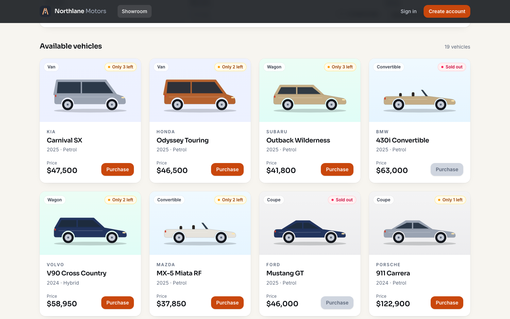 **Showroom**                               | 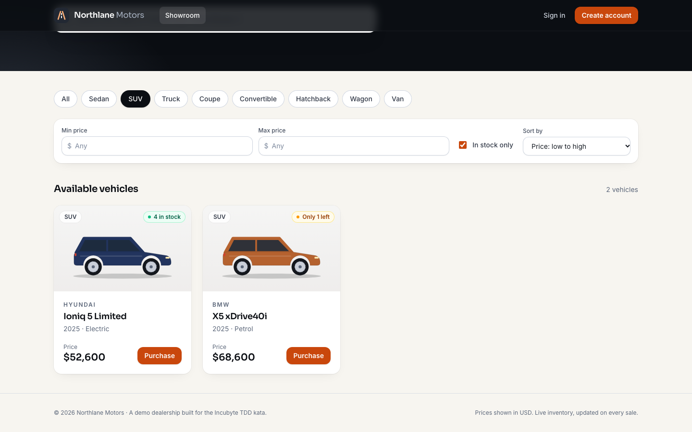 **Filters in the URL** (`?category=SUV&inStock=true&sort=price_asc`) |
| 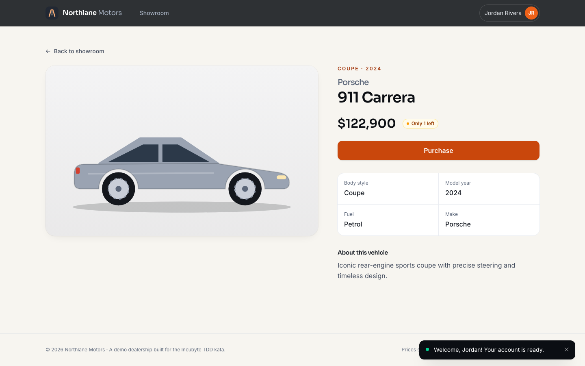 **Vehicle detail**                       | 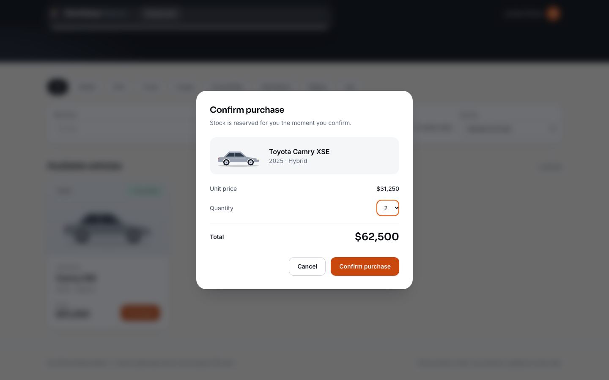 **Purchase confirmation**                                                  |
| 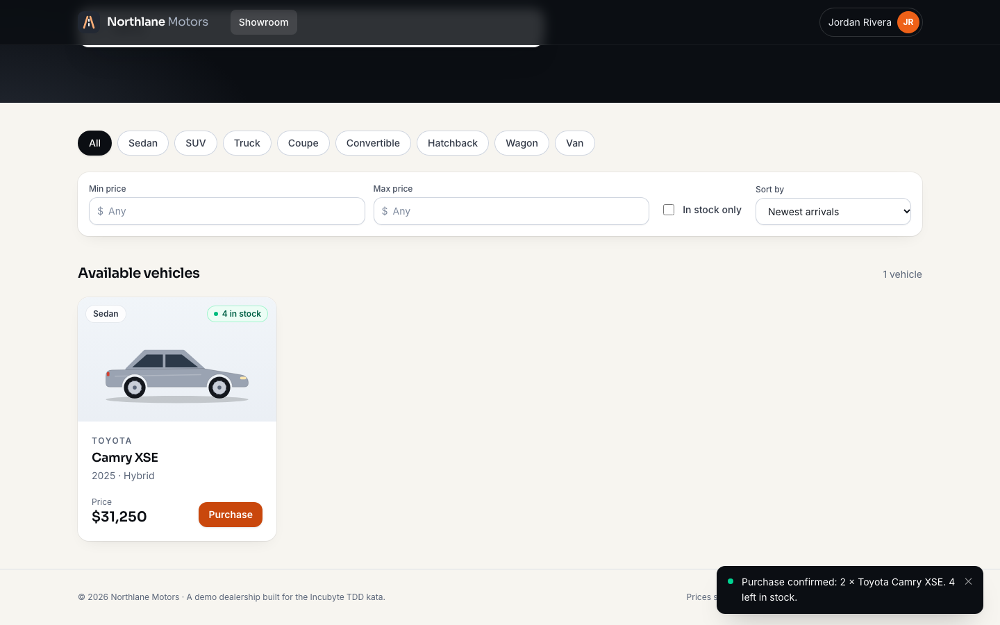 **Stock updated after buying 2** | 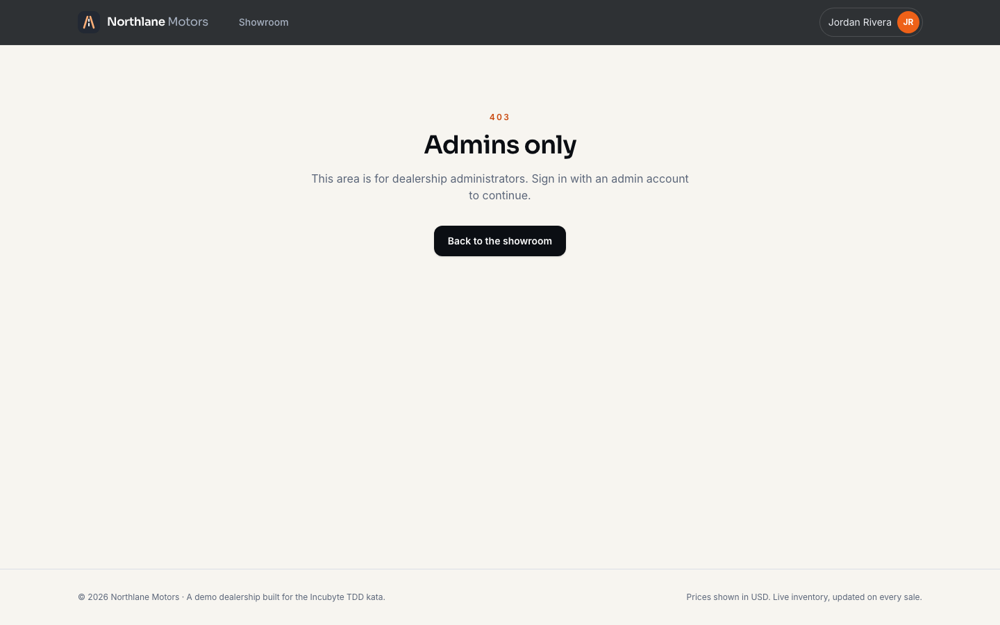 **Customers cannot open admin pages**                                    |
| 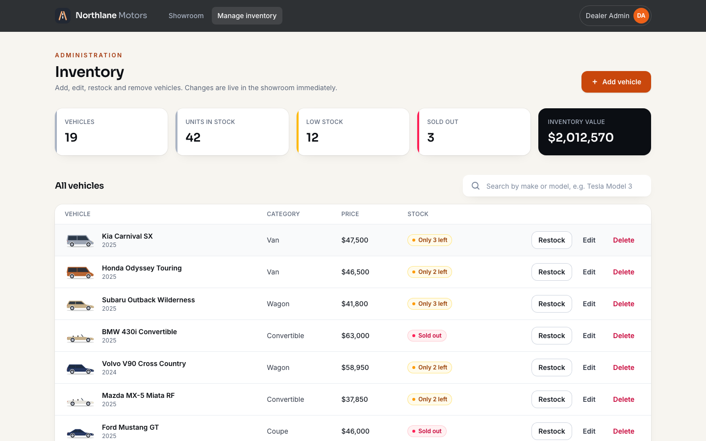 **Admin dashboard**                    | 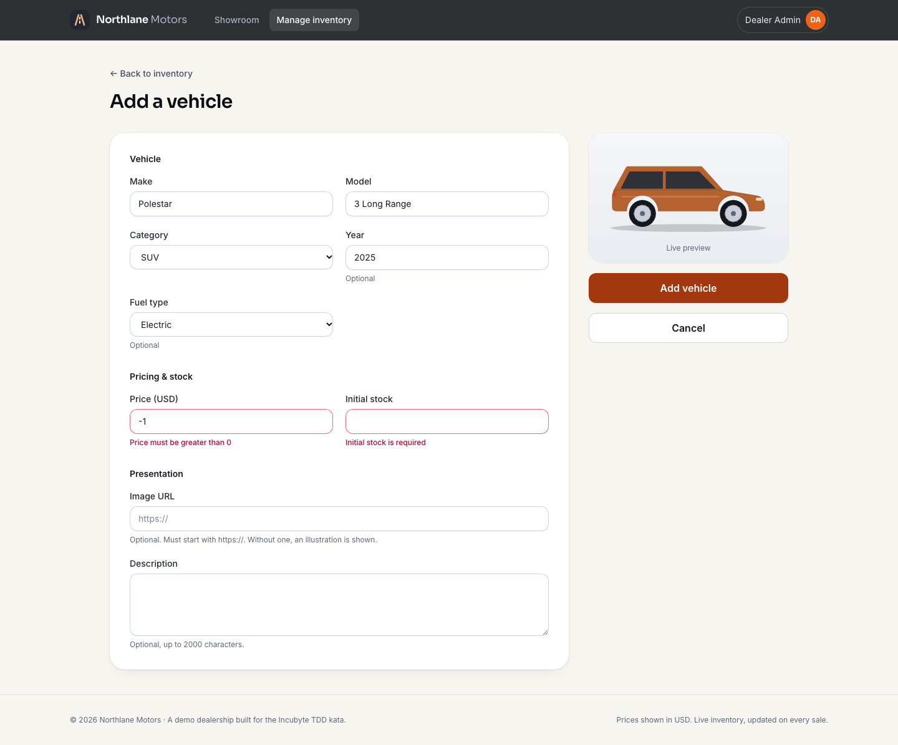 **Add vehicle with validation**                                              |
| 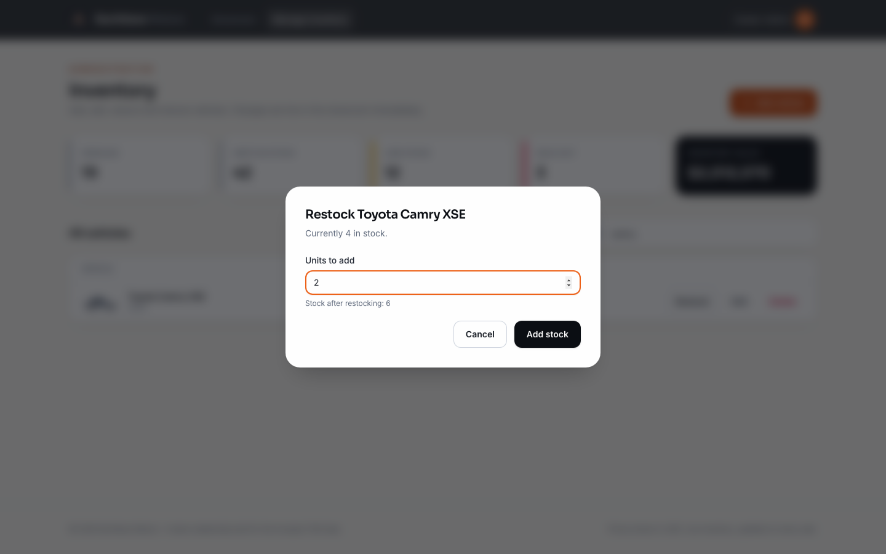 **Restock**                                      | 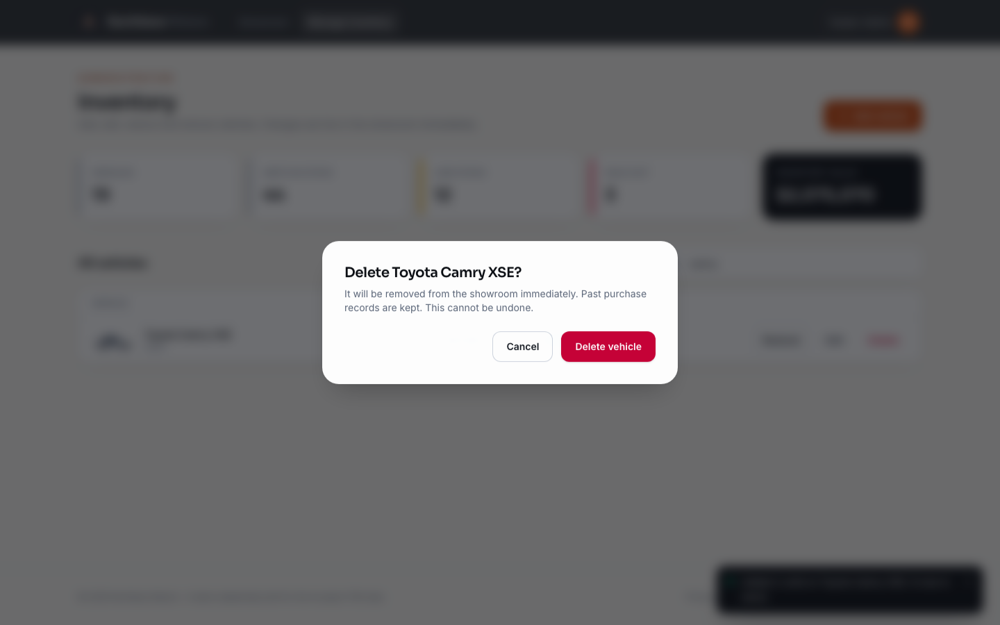 **Delete confirmation**                                                   |
| 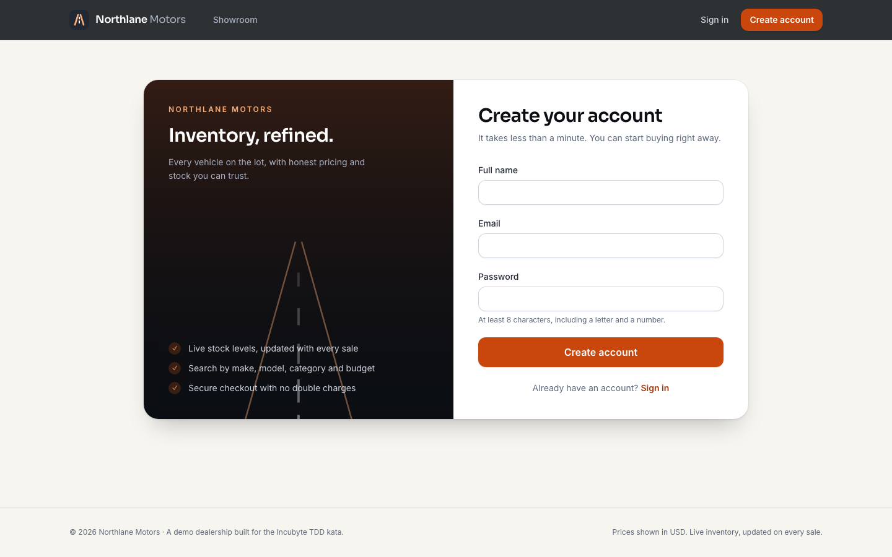 **Registration**                                     | 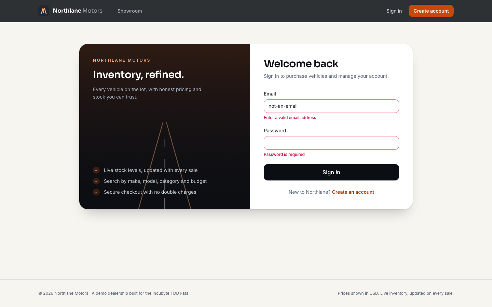 **Sign-in validation**                                                   |
| 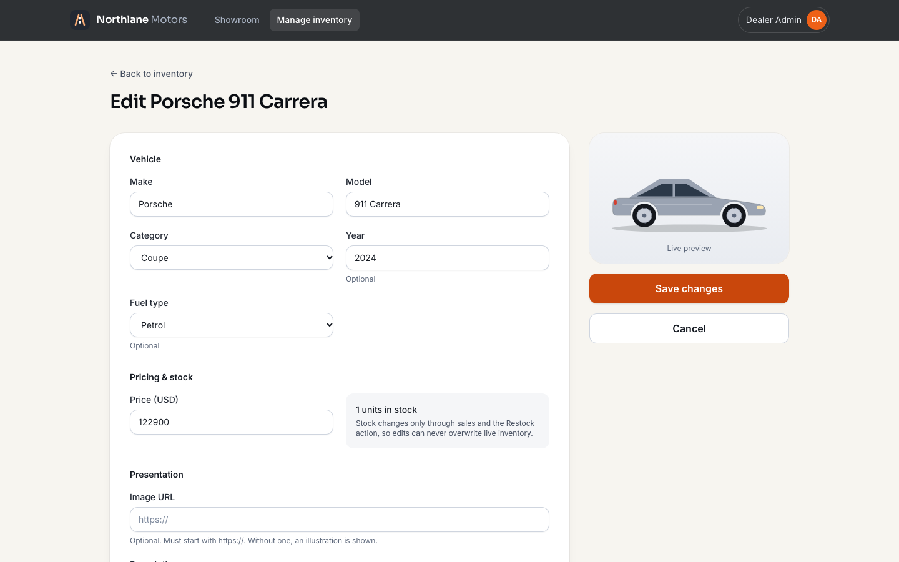 **Edit (stock not editable)**          | 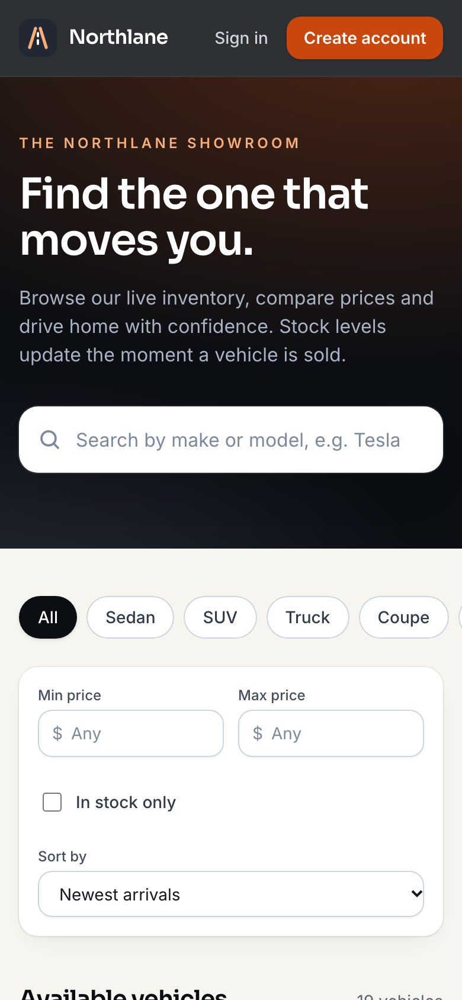 **Mobile**                                                                          |

## Development process

The Git history follows **Red → Green → Refactor**: almost every feature is a
`test: add failing tests for …` commit (the message records the failing run)
followed by a `feat:` commit that makes it pass. Examples:
`0fb5b36` → `f9f3a14` (CHECK constraints), `dad627f` → `a839616` (atomic
purchasing), `a4fef13` → `f7a969c` (catalogue UI).

Honest notes about the history:

- **`e4aa3b5`** is labelled as a test commit but also contains the admin UI
  implementation (the GREEN step for `a5f27ab`), because Claude Code's commit helper staged
  everything. It was left as-is rather than rewriting history; `357c4b4`
  explains it.
- **`17f5777`** said its tests passed, but Vitest had reported unhandled
  rejections (exit code 1); **`e192a63`** corrects the test stub and the record.
- The Playwright suite (`d34e55d`) and two coverage-gap test commits were
  written after the features as acceptance/characterisation tests, and say so.
- Bugs found by tests and checks along the way: unescaped `ILIKE` wildcards,
  a trimmed space in card accessible names, a sign-in redirect race (found in a
  real browser, then pinned by a regression test), and an untestable click
  target on cards.

## My AI Usage

> This section states what happened. The "author's review" part at the end is
> for me (Aasthik) to complete in my own words before submission.

### Tools used

- **Claude Code** (Anthropic), desktop app, model **Claude Opus 5.5**. It was
  the only AI tool used in this repository.

### How it was used

I wrote a detailed master prompt (requirements, stack, security, TDD and
documentation rules — it is in [PROMPTS.md](PROMPTS.md)) and gave Claude Code
screenshots of the assignment brief. Claude Code then worked in this repository
end to end:

- **Planning:** inspected the machine, wrote the requirements checklist,
  architecture, data model, API contract and test plan
  ([docs/PLAN.md](docs/PLAN.md)) before any code.
- **Environment:** asked me two questions — which Git identity to commit with,
  and whether to install PostgreSQL 17 with Homebrew (Docker was unavailable);
  I chose the answers.
- **TDD implementation:** wrote the failing tests, ran them, implemented the
  code, ran them again, and committed each step — backend, frontend and E2E.
- **Verification:** ran lint, type-checks, all test suites, coverage and
  production builds; checked the UI in headless Chromium at desktop and mobile
  sizes and captured the screenshots.
- **Documentation:** wrote this README, the test report and the transcript
  exporter used for PROMPTS.md.

Every commit made with AI assistance carries
`Co-Authored-By: Claude Opus 5.5 <noreply@anthropic.com>` (all of them).

### Examples of prompts

- The master prompt in [PROMPTS.md](PROMPTS.md) (my only free-text prompt).
- My answers to Claude Code's questions: _"Aasthik Tripathi"_ as the Git
  author; _"Yes, use Homebrew"_ for PostgreSQL.

### Accepted, modified and rejected suggestions

- **Accepted:** the overall design — modular monolith, injected dependencies,
  HttpOnly cookie + signed double-submit CSRF, conditional-UPDATE purchases,
  idempotency keys, DB CHECK constraints, URL-synced filters, generated SVG art.
- **Changed during the work (by the AI, after tests or checks failed):**
  ILIKE escaping; accessible-name spacing; the guest-only guard redirect;
  stretched-link cards; a lazy Prisma stub; React-recommended state syncing
  instead of `setState` in effects (the hooks linter rejected the first version).
- **Rejected options (with reasons recorded in the commits/plan):** letting `PUT`
  edit stock (lost updates); storing tokens in `localStorage` (XSS exposure);
  bleeding-edge majors such as an 8.0 release candidate of Prisma and
  TypeScript 7 (not stable or not supported by `typescript-eslint`); mixing two
  Vite versions (unified on Vite 8).

### How the output was checked

- Every behaviour is pinned by tests that were seen failing first (or are
  labelled as characterisation tests), run against a real PostgreSQL database.
- Concurrency tests were re-run repeatedly to rule out flakiness.
- Lint, strict type-checking, formatting, production builds and E2E all pass;
  see [docs/TEST_REPORT.md](docs/TEST_REPORT.md).
- No secrets were printed or committed; local admin credentials live only in
  the untracked `.env`.

### Limitations of the AI-assisted process

- The AI made mistakes that were caught and corrected in the open (see
  [Development process](#development-process)).
- CI has not run on GitHub yet (no remote configured at the time of writing).

### Author's review

_To be completed by Aasthik before submission: which parts you reviewed line by
line, anything you changed by hand, and what you would do differently._

## Known limitations and future improvements

- **No refresh tokens.** Sessions last 60 minutes, then the user signs in again.
  Logout clears the cookies but a copied token stays valid until it expires
  (deleted users are still rejected immediately). Next step: short access token
  - rotating refresh token stored server-side.
- **Rate limiting is in-memory** (per process). A multi-instance deployment needs
  a shared store such as Redis.
- **Registration reveals that an e-mail is taken** (409) — a usability trade-off
  mitigated by rate limiting.
- **Stock can only go down through purchases.** There is no "adjust down"
  (damage, write-off) operation; restocks are not audited like purchases.
- **No purchase history UI** for customers, although purchases are recorded.
- **Sorting by make** follows the database collation (`C` locale in the local
  cluster, so it is case-sensitive).
- **Images** are https URLs or generated illustrations; there is no upload.
- **Prices** are formatted in one currency (`VITE_CURRENCY`, default USD).
- **Browsers:** E2E runs on Chromium only.
- **Runtime versions:** developed and verified on Node 25.8; CI pins Node 22,
  which was not run locally.
- **Docker Compose** is provided but was not exercised (Docker was not installed
  on the development machine; `scripts/db.sh` was used instead).
- **Not deployed;** CI not yet executed on GitHub.

## Deployment notes

The app is deployment-ready but not deployed. A minimal production setup:

1. Provision PostgreSQL and set `DATABASE_URL`, a strong `JWT_SECRET`,
   `NODE_ENV=production`, `CORS_ORIGINS` and `TRUST_PROXY` (usually `1`).
2. `npm ci && npm run build`, then `npm run db:migrate` and
   `npm run admin:create -- --email … --name …`.
3. Start the API with `npm start -w backend` (health check: `GET /api/health`,
   returns 503 when the database is unreachable).
4. Serve `frontend/dist` and proxy `/api` to the API **on the same origin**
   (Nginx, Caddy, or a platform rewrite). The session cookie is
   `SameSite=Strict` and `Secure`, so the site must be served over HTTPS and
   the SPA must not live on a different site from the API.
